<!-- 8-Bit Pixel Art Typing Loop: Types "Hamza El-Shammaa" -> deletes -> types "Hello there!" in an infinite loop -->

 

<!-- Animated Terminal Window -->

  

---

### Main Skills

### AI / ML & Currently Exploring

---

### Selected Freelance & Client Architecture *(Private / NDA)*

*Architectural highlights from production commercial systems delivered under NDA:*

- **AI Talent Acquisition & Cross-Lingual Vector Matching Platform** (`Next.js 16` · `NestJS 11` · `Expo React Native` · `Supabase pgvector`)
  - Architected a 3-package monorepo (Web client, REST/WebSocket API backend, and cross-platform iOS/Android mobile app with full English/Arabic RTL localization and live translated chat).
  - Engineered a fault-tolerant 5-stage PDF resume ingestion pipeline combining regex pre-extraction, Arabic-Indic normalization, and schema-enforced native PDF extraction across **Anthropic Claude**, **OpenAI**, and **Google Gemini**.
  - Built an in-process multilingual embedding engine (`multilingual-e5-base`, 768-dim) paired with **PostgreSQL `pgvector` HNSW indexes** for cross-lingual (Arabic ↔ English) multi-vector cosine matching.

- **Cross-Platform Smart TV Media Streaming Suite** (`Kotlin 2.x` · `Jetpack Compose for TV` · `Media3 + FFmpeg` · `Room FTS5` · `SolidJS` · `Go`)
  - Built a native **Android TV & Fire TV** player achieving **60fps D-pad navigation on 1GB RAM devices**, with zero-allocation streaming playlist parsers, **Room FTS5** instant search across **100,000+ records**, a 2D virtualized EPG timeline grid, and a custom **Media3 + FFmpeg audio decoder** (`AC3`, `E-AC3`, `TrueHD`, `DTS`).
  - Engineered a companion **SolidJS + TypeScript** Smart TV monorepo for **Samsung Tizen 5.5+** and **LG webOS 5+** (compatible down to Chromium 68 over `file://`), backed by a Dockerized **Go** metadata service.

---

### Featured Open-Source Repositories

| Repository | Description | Tech |
| :--- | :--- | :--- |
| **[`3D-Portfolio-Website`](https://github.com/HamzaElshammaa/3D-Portfolio-Website)** | **Interactive 3D & Multi-Theme Developer Portfolio** — Dual-mode portfolio blending an interactive 3D Spline WebGL scene state machine (with hardware/FPS watchdog fallback) and a pluggable 2D multi-theme architecture. | `Next.js 16` `React 19` `Spline 3D` `Tailwind 4` `Vitest` |
| **[`xsquare-feast-menu`](https://github.com/HamzaElshammaa/xsquare-feast-menu)** | **Xsquare Artisanal Food Truck Digital Experience** — High-converting interactive digital menu and brand showcase engineered for sub-second mobile QR load times and fluid motion. | `React` `TypeScript` `Vite` `Tailwind CSS` |
| **[`RamadanApp`](https://github.com/HamzaElshammaa/RamadanApp)** | **Cross-Platform Ramadan Companion App** — Mobile application for live prayer countdowns, astronomical Hijri date calculation, and custom Adhan audio notifications. | `React Native` `Expo Router` `TypeScript` `Reanimated` |
| **[`unimail-ai-assistant`](https://github.com/HamzaElshammaa/unimail-ai-assistant)** | **Headless AI University Email Pipeline** — Automated EWS/OWA fetcher that navigates legacy Exchange firewall restrictions, extracts structured course deadlines via Gemini/OpenAI, and dispatches alerts to Telegram & Google Calendar via n8n. | `Python` `Gemini API` `Exchange EWS` `n8n` `Telegram` |
| **[`markitdown-pdf-ocr-pipeline`](https://github.com/HamzaElshammaa/markitdown-pdf-ocr-pipeline)** | **Vision LLM PDF-to-Markdown & Slide OCR Pipeline** — Hybrid document ingestion utility combining `pdfminer.six` sparse-text page detection with Microsoft `MarkItDown` and Google Gemini Vision. | `Python` `MarkItDown` `Gemini Vision` `PDFMiner` |
| **[`ddos-mitigation-pipeline`](https://github.com/HamzaElshammaa/ddos-mitigation-pipeline)** | **Real-Time DDoS Detection & Graduated Mitigation Engine** — 4-stage network security pipeline: statistical benign baseline modeling, composite Z-score anomaly detection, Token-Bucket/iptables mitigation, and a live Streamlit dashboard. | `Python` `Streamlit` `Pandas` `Docker` |
| **[`autonomous-intersection-optimization`](https://github.com/HamzaElshammaa/autonomous-intersection-optimization)** | **Autonomous Intersection Vehicle Scheduling** — Multi-objective metaheuristic optimization comparing FCFS, Simulated Annealing (SA), and Genetic Algorithms (GA) to minimize delay and energy across conflict matrices. | `Python` `NumPy` `Jupyter` `GA / SA` |
| **[`hotel-booking-graph-analytics`](https://github.com/HamzaElshammaa/hotel-booking-graph-analytics)** | **Hotel Booking & Review Knowledge Graph Analytics** — Relational and graph-oriented exploratory data analysis over multi-table hospitality datasets, user demographics, and sentiment reviews. | `Python` `Jupyter` `SQLite` `Pandas` |
| **[`tactical-battle-minimax-ai`](https://github.com/HamzaElshammaa/tactical-battle-minimax-ai)** | **Turn-Based Tactical Combat Solver** — Adversarial search engine in Java implementing Minimax and Alpha-Beta Pruning over game-state trees to compute optimal combat sequences. | `Java` `Minimax` `Alpha-Beta` |
| **[`unity-ar-battle-adventure`](https://github.com/HamzaElshammaa/unity-ar-battle-adventure)** | **Unity 6 Augmented Reality Multi-Stage Game** — Mobile AR experience built with AR Foundation & XR Interaction Toolkit featuring plane-tracked number puzzles, physics creature capture, and AR combat. | `C#` `Unity 6` `AR Foundation` `XR Toolkit` |
| **[`phantom-range-vr-shooter`](https://github.com/HamzaElshammaa/phantom-range-vr-shooter)** | **Phantom Range VR Tactical Shooter** — Immersive Virtual Reality shooting range and training simulation with 6DoF weapon handling, reactive targets, and spatial audio. | `C#` `Unity` `XR Toolkit` `OpenXR` |
| **[`unity-vr-knight-interactions`](https://github.com/HamzaElshammaa/unity-vr-knight-interactions)** | **Unity 6 VR Interactive Sandbox** — VR locomotion, grab interactions, and custom 3D medieval character animation triggers built on Unity 6 and XR Interaction Toolkit 3.3. | `C#` `Unity 6` `XR Toolkit` `3D Animation` |
| **[`Scripting`](https://github.com/HamzaElshammaa/Scripting)** | **Automated Academic Portal Evaluation Suite** — Headless browser automation scripts that streamline repetitive university course and staff evaluation forms. | `Python` `Selenium WebDriver` |
| **[`Tomasulo`](https://github.com/HamzaElshammaa/Tomasulo)** | **Tomasulo's Algorithm Microprocessor Simulator** — Cycle-accurate out-of-order instruction scheduling simulator with reservation stations, register renaming, and CDB execution. | `Java` `Computer Architecture` |
| **[`OpenGL_2D_Game`](https://github.com/HamzaElshammaa/OpenGL_2D_Game)** | **Space Infinite Runner** — Custom 2D arcade game rendered from scratch with OpenGL primitives, collision physics, and dynamic obstacle spawning. | `C` `C++` `OpenGL` |

---

### Connect with me!

  
  &nbsp;
  
  &nbsp;
  

 

> [!IMPORTANT]  
> **Hiring or looking to collaborate?** <a href="https://calendly.com/hamzahelshammaa">Book a 15-minute chat on Calendly</a> or reach out directly at <a href="mailto:hamzahelshammaa@gmail.com">hamzahelshammaa@gmail.com</a>.

